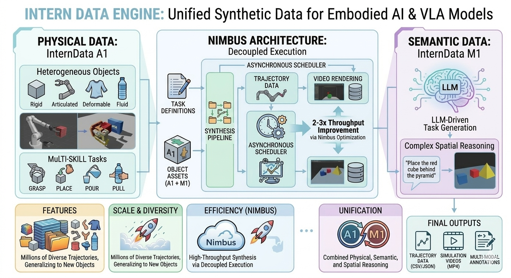

# EgoEngine：在 InternDataEngine 上生成配对 Human Ego 视频

本仓库直接基于 InternDataEngine 开发，根目录保留完整上游源码和 Git 历史，
包括 `nimbus/`、`workflows/`、`configs/`、`deps/`、`policy/`、`tests/`。
上游基线 `2a0a21f2c836df97c925729084e13d68950b4deb` 是本仓库的 Git 祖先。
实际使用的 CuRobo Python/CUDA 源码在 `deps/curobo/`，人物导入器在
`deps/blender_mmd_tools/`，原始 Worker 人体 IK 和渲染代码在 `work/human-natural-v4/`、`work/human41/`，
可选动漫版本在 `work/anime-human-v1/`。

## 迁移前先确认复现目标

新机器从公开来源重新安装、下载资产并生成配对 episode，使用
[全新部署与新任务转换](migration/FRESH_EPISODE.md)。此路径不需要访问原服务器，
也不需要下载旧复现包。当前目标是最初的 **Worker 非动漫人物**；
新机器机械臂任务和 Worker 三视角调试视频已跑通：1490 帧源轨迹、99.33 秒完整任务，
调试渲染为 640×360、每 3 个源帧采样一次。详细对照与滞后修复见
[调试重放说明](migration/DEBUG_REPLAY.md)。

扩展到挂杯、双手交接、关门等新任务，参见 [任务候选与逐步生成管线](work/task-pairs/README.md)。该入口独立保存每条任务的完整物体/连杆轨迹、接触事件和时间轴；以逐条验收报告为准，不把配置存在当成已经跑通。

全部配置的依赖审计、按任务族的实际规划测试，以及 Hugging Face 数据能否精确重放的边界，见 [任务覆盖与数据重放审计](work/task-audit/README.md)。论文的 70 项任务、仓库的 1128 个 YAML 和 59 个源码任务族不是同一统计口径。

下表区分新部署与历史复现；它们共享环境，但不能混用 episode：

| 目标 | 输入 | 验收结果 |
| --- | --- | --- |
| 重新运行双臂叠块、抬托盘任务 | 仓库代码、Isaac Sim 4.1、任务资产 | 官方 `plan_with_render` 工作流，加本项目的任务级 `stable_place` 修复；独立检查叠放和最终保持 |
| 原始 Worker 非动漫人物配对 | 本次验收通过的机器人 episode、Worker 原生 USD 与随包动作库 | 独立人体 IK，保持物体轨迹与时间轴，输出三视角视频 |
| 可选：复现历史安柏同步视频 | 同一环境、原 **1507 帧** episode、接触参考、安柏原生网格与骨架 | 原物体轨迹和时间轴保持不变，安柏使用自己的骨架 IK，输出三视角视频 |

新部署使用 [Worker 入口](migration/FRESH_EPISODE.md#原始-worker-真人风格人物本次目标)。
历史安柏入口保留原 1507 帧任务的接触参考。
新入口 `export_episode.py` 和 `solve_motion.py --native-contacts` 根据新任务的物体与事件生成接触，
支持本项目同一种双臂叠块/抬盘任务的可变帧数；它不是任意任务的通用转换器。
重新规划得到的新 episode 帧数可能变化；不能混用新轨迹和旧人物动画。
人物视频是原物体轨迹的视觉重放，不是重新验证人体接触动力学。
以下步骤完整覆盖“在新机器跑机器人任务”和“在新机器重建原配对视频”。

## 1. Clone 并建立独立运行目录

在有 NVIDIA RTX GPU 的 **Linux x86_64** 机器执行。macOS 只用于编辑/部分资产转换，
不能运行这里的 Isaac Sim GPU 管线。

```bash
git clone https://github.com/steinate/egoengine.git
cd egoengine
export EGO_ROOT="$(pwd -P)"
export PAIR_ROOT=/data/egoengine-run  # 改为有足够空间的目录，必须在代码仓库外
python3 migration/prepare_workspace.py "$PAIR_ROOT"
git rev-parse HEAD
```

`prepare_workspace.py` 只复制受版本管理的任务脚本、调整部署路径并建立链接；
**不下载模型、不安装环境、不改动 VLA-Infra 原部署**。遇到已有不同文件会停止。
后续更新代码时，应在新运行目录重新准备，或人工比较已有副本后更新；不要忽略冲突。
脚本写出的 `workspace-source.json` 记录代码来源。请保存本次 commit，避免以后使用变化的 `main`。

运行目录结构：

```text
/data/egoengine-run/
├── runtime41/                     # Isaac Sim 4.1.0，python.sh 必须直接位于此目录
├── env/python310/                 # 安装的额外 Python 包
├── env/curobo41-built/             # 在目标 GPU 上编译的 CuRobo
├── assets/InternDataAssets/        # assets/、curobo/、panda_drake/
├── src/InternDataEngine41 -> .../egoengine  # 指向当前 checkout，非另一份源码
├── robot-stack-v2/                 # 任务配置、运行、验收与新 trial
├── human-stack-v3/source/          # 当前选定 episode 的不可变输入
├── human-natural-v4/               # 原始 Worker 的 IK、蒙皮、视频与校验
├── anime-human-v1/                 # 角色导出、IK、蒙皮、渲染、delivery/
├── human41/usd_python.sh           # USD/NumPy 工具入口
└── run_env41.sh                    # 转发到当前 checkout 的引擎入口
```

## 2. 安装 Isaac Sim 4.1 和依赖

已验证组合：**Isaac Sim 4.1.0 / Python 3.10 / Torch 2.2.2+cu118 /
CUDA 11.8 / GCC 11 / NVIDIA L20**；实测系统为 Ubuntu 24.04.2、驱动 535.154.05。
这是实际验证记录，不代表所有 GPU/驱动/操作系统组合均已验证。

按 [环境安装步骤](migration/README.md#环境安装) 完成：

1. 从 [资产与环境链接](ASSETS.md) 获取 **4.1.0** SDK，放到 `$PAIR_ROOT/runtime41/`。
   已确认 NVIDIA 的 4.1.0 旧版直链，见安装文档；不要用最新版代替。
2. 安装系统依赖、CUDA 11.8 和 GCC 11。
3. 使用 SDK 自带 Python 和 `work/isaac41/requirements-engine41.txt` 安装依赖。
   不额外安装 `usd-core`、Torch 或 Warp 覆盖 Kit 自带版本。
4. 完成下一节任务资产准备后，从本仓库 `deps/curobo/` 构建规划器。

安装文档包含完整命令、构建路径、GPU 架构设置和环境检查入口。**不要直接安装根目录
`requirements.txt` 来替代本项目 4.1 的已验证依赖集**；上游通用清单含另一个 USD 版本。

## 3. 按需获取任务资产，先查看下载范围

所有下载地址、版本和限制见 [ASSETS.md](ASSETS.md)。无需下载整个 InternData-A1，
也无需下载旧的 22.8 GB 复现包。

```bash
cd "$EGO_ROOT"
# 只输出清单与总大小，不访问网络：
python3 migration/task_assets.py --output "$PAIR_ROOT/task-assets.json"
```

当前选择 **1087 个文件，2,381,928,033 字节（约 2.38 GB）**，是已有清单中的保守任务子集：
双臂模型、叠块/托盘、桌面、环境/材质样本、官方干扰物、CuRobo 配置及 URDF/网格。
它不是理论最小集；保留这些样本是为了匹配原来的场景采样。
默认不下载，只有在新机器确实缺少资产时才显式执行：

```bash
python3 migration/task_assets.py --root "$PAIR_ROOT" --download
python3 migration/task_assets.py --root "$PAIR_ROOT" --verify
```

已有资产可按同一目录结构复用；验证命令只读文件。下载器检查 LFS SHA256 或 Git blob SHA1，
不会覆盖已有不同文件。上游 URL 使用 `main`，若内容变化导致散列不符，应寻找原版本或使用
VLA-Infra 原资产，不能删除校验来继续。中断的 `.ego-download-part` 需检查并移除后再重试。

**不要无参数执行上游 `scripts/download_assets.sh`：其默认模式是全量下载。**
本项目入口会建立三个独立链接：
`workflows/simbox/assets → …/InternDataAssets/assets`、
`curobo → …/InternDataAssets/curobo`、`panda_drake → …/InternDataAssets/panda_drake`。
`assets` 不能误指向父目录 `InternDataAssets`。

现在完成 [CuRobo 构建与环境检查](migration/README.md#编译-curobo-并检查环境)，
确认日志中出现 `ENVIRONMENT_OK` 再继续。

## 4. 跑完整机器人任务并验收

```bash
cd "$EGO_ROOT"
# 每个 shell 设置与安装时相同的 CUDA/编译器变量，参见安装文档。
bash migration/run_engine.sh "$PAIR_ROOT" "$PAIR_ROOT/robot-stack-v2/configure.py"
bash migration/run_engine.sh "$PAIR_ROOT" -m unittest human_pair.test_geometry

# 使用新的 trial 名称，避免覆盖已有结果；pipefail 防止 tee 掩盖失败。
set -o pipefail
bash migration/run_engine.sh "$PAIR_ROOT" "$PAIR_ROOT/robot-stack-v2/run.py" \
  --trial new-machine-trial01 --seed 42 2>&1 | tee "$PAIR_ROOT/logs41/robot-trial01.log"
bash "$PAIR_ROOT/human41/usd_python.sh" "$PAIR_ROOT/robot-stack-v2/validate_stack.py" \
  "$PAIR_ROOT/robot-stack-v2/new-machine-trial01"
```

`configure.py` 从上游 `stack_cubes_lift/lr.yaml` 生成独立配置；
`run.py` 执行官方工作流和实际物理仿真，使用本项目修复过的放置技能，不手写物体运动代替规划。
完成标准同时包括：

- 日志出现 `Task is successful`，trial 的 `result.json` 中 `official_workflow_frames > 0`。
- `validate_stack.py` 成功退出，生成 `stack-validation.json`，检查撤手后堆叠、抬盘和末尾保持。
- trial 中有 `initial-scene.usdc`、`diagnostic-tracks.npz`、`events.json`；
  官方 writer 的 episode、相机视频/记录在 `robot-stack-v2/official-output/`。

失败时保留日志和 trial，更换 trial 名称重试，不把失败结果当作可用配对输入。
此前异地恢复测试完整跑通 **1522 个记录帧**（含初始采样），不要求新运行恰好等于原 1507 帧。
原始诊断位姿为位置 XYZ 与四元数 WXYZ，采样物理步长 1/30 s；视频 15 fps。
物理时间与视频时间不能混为同一字段。

官方输出的具体层级为
`official-output/BananaBaseTask/split_aloha/stack_lift_cubes/stack_verified_v2/<本次时间戳>/`。
其中 `images.rgb.head/demo.mp4` 是机器人主视角视频，`lmdb/` 保存逐帧数据。
如需把本次官方记录导出为 NPZ/CSV，可将下面 `EPISODE` 替换为实际时间戳目录：

```bash
EPISODE="$PAIR_ROOT/robot-stack-v2/official-output/BananaBaseTask/split_aloha/stack_lift_cubes/stack_verified_v2/本次时间戳"
test -d "$EPISODE/lmdb"
bash "$PAIR_ROOT/run_env41.sh" "$EGO_ROOT/human_pair/export_dual_grasp.py" \
  "$EPISODE" "$PAIR_ROOT/robot-stack-v2/new-machine-trial01/export" \
  "$PAIR_ROOT/robot-stack-v2/task.yaml"
```

得到 `object-and-robot-tracks.npz` 和 `verification.json`；导出位姿是原父节点局部坐标，
不是已经转换好的 `world-tracks.npz`。此步骤不自动生成新任务的人体接触参考。

## 5. 准备同一 episode 的人类视频输入

为了复现已验收的安柏配对视频，需要保存过的原任务，而不是上一节新规划的随机结果。
我们已将所需文件逐个列出：

- [输入清单与大小/SHA256](provenance/original-episode-inputs.json)
- [rsync 文件列表](migration/original-episode-files.txt)
- [校验文件](migration/original-episode.sha256)

共 **21 个文件、89,711,203 字节（约 85.6 MiB）**：原场景、物体轨迹、原机器人视频、
接触参考，以及安柏的原生骨架/网格/贴图与导入审计。
不包含 SDK、场景外部依赖、逐帧蒙皮缓存和渲染输出；外部场景资产仍需要第 3 步。
模型授权限制见 [ASSETS.md](ASSETS.md)，这些项目数据没有公开下载 URL。
它们保留在 VLA-Infra，可在你决定迁移时只复制这些输入：

```bash
# 以下是新机器上按需执行的传输命令，不是安装脚本的自动行为。
# VLA-Infra 地址仅在可访问该内网的机器上有效。
rsync -av --files-from="$EGO_ROOT/migration/original-episode-files.txt" \
  -e 'ssh -p 2222' \
  root@172.31.21.245:/vepfs/public/pengjiaqi/interndata-human-pair/ "$PAIR_ROOT/"
(cd "$PAIR_ROOT" && sha256sum -c "$EGO_ROOT/migration/original-episode.sha256")
```

也可以通过你自己的文件存储迁移同一清单；不必打包所有资产。
**先校验，再修改 USD 中的绝对路径。** 准备脚本已建立人物 `source/` 和接触参考链接。
在新运行目录重定位场景外部引用：

```bash
bash "$PAIR_ROOT/human41/usd_python.sh" "$EGO_ROOT/migration/relocate.py" \
  "$PAIR_ROOT" --usd-only --report "$PAIR_ROOT/logs41/usd-relocation.json"
```

这一步仅处理新副本，不修改原服务器。重定位后的 USD 散列自然变化，NPZ 物体轨迹应保持不变。
若想从官方下载的 PMX 重新导出安柏，而不是复用约 9 MB 的原生导出，见
[可选：原生角色导入](migration/README.md#可选原生角色导入)。
**下载 PMX 不能替代原 episode 与接触参考。**

## 6. 解人物 IK、烘焙、检查三帧

```bash
export OPENBLAS_NUM_THREADS=1
bash "$PAIR_ROOT/human41/usd_python.sh" "$PAIR_ROOT/anime-human-v1/solve_motion.py"
bash "$PAIR_ROOT/human41/usd_python.sh" "$PAIR_ROOT/anime-human-v1/verify.py"
bash "$PAIR_ROOT/human41/usd_python.sh" "$PAIR_ROOT/anime-human-v1/bake_and_template.py"

bash "$PAIR_ROOT/run_env41.sh" "$PAIR_ROOT/anime-human-v1/render.py" \
  --frames 0,780,1506 --preview --view both --job preview
```

IK 使用安柏自己的手指关节、臂长与骨架，读取同一任务的空间接触参考；保持躯干直立、
允许脚下支撑面低于桌脚。它不把机器人关节角直接赋给人体。
`verify.py` 检查全部 1507 帧物体数组相等、骨段长度、固定站姿和相机；
`bake_and_template.py` 在本机生成全部 `skin-cache/`，无需搬运旧缓存。

查看 `anime-human-v1/preview/ego/` 与 `preview/front/` 的 PNG，
以及 `preview/verification-both-preview.json`。物体位置/旋转误差应小于 `1e-6`。
出现贴图缺失、USD unresolved assets、错误视角或轨迹校验失败时，不开始全量渲染。
第一次 Kit 启动与着色器编译可能较慢；GPU 渲染要求真实可用的 NVIDIA 驱动和 Vulkan。

## 7. 渲染完整 1507 帧并编码

建议先串行渲染两个视角，减少同时占用显存。不要在此期间修改动画、渲染代码或混入其他运行的 PNG。
以下会生成全部图片，占用显著磁盘空间，请事先用 `df -h "$PAIR_ROOT"` 检查。

```bash
bash "$PAIR_ROOT/run_env41.sh" "$PAIR_ROOT/anime-human-v1/render.py" \
  --view ego --start 0 --end 1507 --job full \
  > "$PAIR_ROOT/anime-human-v1/render-ego.log" 2>&1
bash "$PAIR_ROOT/run_env41.sh" "$PAIR_ROOT/anime-human-v1/render.py" \
  --view front --start 0 --end 1507 --job full \
  > "$PAIR_ROOT/anime-human-v1/render-front.log" 2>&1
bash "$PAIR_ROOT/human41/usd_python.sh" "$PAIR_ROOT/anime-human-v1/encode.py"
```

`encode.py` 校验所有帧、动画/渲染代码散列、物体误差和最终视频帧数；
只看到 MP4 文件不等于通过验收，须看到 `FULL_PAIR_COMPLETE`。
结果位于 `$PAIR_ROOT/anime-human-v1/delivery/`：

| 文件 | 内容 |
| --- | --- |
| `amber-ego-full.mp4` | 人类第一人称，1280×720 |
| `amber-front-full.mp4` | 正面人体视角，1280×720 |
| `robot-ego-front-full.mp4` | 原机器人、ego、正面三视角同步 |
| `paired-world-trajectories.npz` | 原物体轨迹、源帧索引、视频时间、手部参数和相机 |
| `video-verification.json`、`checksums.json` | 全片帧数、15 fps、误差与内容校验 |

完整视频均为 **1507 帧 / 15 fps / 100.466667 秒**。
重建的 PNG/视频可因硬件和渲染器非确定性产生像素差异；配对保证针对源帧、物体轨迹和时间轴。

## 验证范围与常见问题

- 已完成：独立目录恢复环境并校验，原视频第 0/780/1506 帧双视角重渲染，
  从仓库根目录源码完整重跑机器人叠块/抬盘并验收。
  记录见 [机器人验收](provenance/migration-robot-stack-validation.json) 和
  [渲染验收](provenance/migration-render-verification.json)。
- 本次文档整理：不下载大文件；补充目录准备、按需下载清单、输入校验和逐步命令。
  **没有声称已在一台完全空白机器重新下载、编译并重渲染全片。**
  新环境检查入口已在独立恢复副本运行通过，记录见
  [环境检查](provenance/readme-environment-check.json)；1087 个所选资产已核对原部署散列。
- `ModuleNotFoundError: pxr/omni/warp`：检查是否使用对应 SDK 入口；`MotionGen`
  必须在 Kit 初始化后测试，不用系统 Python 直接导入判断运行环境坏了。
- HDR 列表为空：检查 `assets` 链接层级和 `envmap_lib`，不要只下载机器人/方块。
- CUDA 编译错误/架构不匹配：核对 Torch 的 cu118、CUDA 11.8、GCC 11，重新在目标 GPU 编译；
  不能把 L20 二进制直接当作其他 GPU 已验证版本。
- 1507 帧断言失败：输入不是原 episode；不要删除断言或截断新轨迹。
- 新任务转人物：同一种叠块/抬盘任务使用 [新任务转换入口](migration/FRESH_EPISODE.md)。
  历史 `human-stack-v3/export_source.py` 仍绑定原 trial 和 1507 帧，不用于新任务。

[环境与可选导入详细说明](migration/README.md) · [资产下载链接](ASSETS.md) ·
[历史实现与结果](docs/human-pair.md) · [可选旧快照说明](migration/OFFLINE_SNAPSHOT.md)

以下保留原项目介绍、署名和引用。

---

<div align="center">

# InternDataEngine: Pioneering High-Fidelity Synthetic Data Generator for Robotic Manipulation

</div>

<div align="center">

[](https://arxiv.org/abs/2511.16651)
[](https://arxiv.org/abs/2601.21449)
[](https://arxiv.org/abs/2510.13778)
[](https://huggingface.co/datasets/InternRobotics/InternData-A1)
[](https://huggingface.co/datasets/InternRobotics/InternData-M1)
[](https://internrobotics.github.io/InternDataEngine-Docs/)

</div>

## 💻 About

<div align="center">
  
</div>

InternDataEngine is a synthetic data generation engine for embodied AI that powers large-scale model training and iteration. Built on NVIDIA Isaac Sim, it unifies high-fidelity physical interaction from InternData-A1, semantic task and scene generation from InternData-M1, and high-throughput scheduling from the Nimbus framework to deliver realistic, task-aligned, and massively scalable robotic manipulation data.

- **More realistic physical interaction**: Unified simulation of rigid, articulated, deformable, and fluid objects across single-arm, dual-arm, and humanoid robots, enabling long-horizon, skill-composed manipulation that better supports sim-to-real transfer.
- **More diverse data generation**: By leveraging the internal state of the simulation engine to extract high-quality ground truth, coupled with multi-dimensional domain randomization (e.g., layout, texture, structure, and lighting), the data distribution is significantly expanded. This approach produces precise and diverse operational data, while simultaneously exporting rich multimodal annotations such as bounding boxes, segmentation masks, and keypoints.
- **More efficient large-scale production**: Nimbus-powered asynchronous pipelines that decouple planning, rendering, and storage, achieving 2–3× end-to-end throughput, cluster-level load balancing and fault tolerance for billion-scale data generation.

## 🔥 Latest News

- **[2026/03]** We release the InternDataEngine codebase v1.0, which includes the core modules: InternData-A1 and Nimbus.

## 🚀 Quickstart

Please refer to the [Installation](https://internrobotics.github.io/InternDataEngine-Docs/guides/installation.html) and [Usage](https://internrobotics.github.io/InternDataEngine-Docs/guides/quickstart.html) to start the installation and run your first synthetic data generation task.

For more details, please check [Documentation](https://internrobotics.github.io/InternDataEngine-Docs/).

## License and Citation
All the code within this repo are under [CC BY-NC-SA 4.0](https://creativecommons.org/licenses/by-nc-sa/4.0/). Please consider citing our papers if it helps your research.

```BibTeX
@article{tian2025interndata,
  title={Interndata-a1: Pioneering high-fidelity synthetic data for pre-training generalist policy},
  author={Tian, Yang and Yang, Yuyin and Xie, Yiman and Cai, Zetao and Shi, Xu and Gao, Ning and Liu, Hangxu and Jiang, Xuekun and Qiu, Zherui and Yuan, Feng and others},
  journal={arXiv preprint arXiv:2511.16651},
  year={2025}
}

@article{he2026nimbus,
  title={Nimbus: A Unified Embodied Synthetic Data Generation Framework},
  author={He, Zeyu and Zhang, Yuchang and Zhou, Yuanzhen and Tao, Miao and Li, Hengjie and Tian, Yang and Zeng, Jia and Wang, Tai and Cai, Wenzhe and Chen, Yilun and others},
  journal={arXiv preprint arXiv:2601.21449},
  year={2026}
}

@article{chen2025internvla,
  title={Internvla-m1: A spatially guided vision-language-action framework for generalist robot policy},
  author={Chen, Xinyi and Chen, Yilun and Fu, Yanwei and Gao, Ning and Jia, Jiaya and Jin, Weiyang and Li, Hao and Mu, Yao and Pang, Jiangmiao and Qiao, Yu and others},
  journal={arXiv preprint arXiv:2510.13778},
  year={2025}
}
```

<!--
```BibTeX
@misc{interndataengine2026,
  title={InternDataEngine: A Synthetic Data Generation Engine for Robotic Learning},
  author={InternDataEngine Contributors},
  year={2026},
  }
}
``` -->
